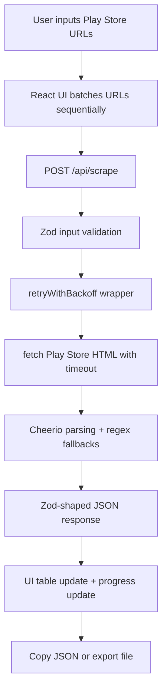

# Play Store Scraper

A production-ready TypeScript scraping service and web UI for extracting Google Play Store developer metadata at scale.

[](#testing)
[](#getting-started)
[](https://www.typescriptlang.org/)
[](LICENSE)

> [!NOTE]
> This repository contains a full-stack scraper application (API + UI). It is not a standalone logging package, but it includes structured request logging and retry diagnostics in the server runtime.

## Table of Contents

- [Title and Description](#play-store-scraper)
- [Features](#features)
- [Tech Stack & Architecture](#tech-stack--architecture)
- [Getting Started](#getting-started)
- [Testing](#testing)
- [Deployment](#deployment)
- [Usage](#usage)
- [Configuration](#configuration)
- [License](#license)
- [Support the Project](#support-the-project)

## Features

- Batch URL processing from a multiline input box (one Google Play URL per line).
- Server-side scraping endpoint at `POST /api/scrape` with schema validation via `zod`.
- Automatic retry with exponential backoff to improve reliability on transient network/parsing failures.
- Per-request timeout enforcement using `AbortController` to avoid hung scraping jobs.
- Extraction pipeline for:
  - App title
  - Studio/developer name
  - Support email
  - Developer email (from contact section)
  - External website URL
  - Download count (`1K+`, `1M+`, `500M+`, etc.)
- Defensive fallback parsing for website/email/download count to maximize useful yield.
- Front-end progress tracking for long URL batches.
- Result table UX with copy-to-clipboard JSON and JSON file export.
- Shared API contract definitions in `shared/` to keep client/server payloads consistent.
- Vite development server integration and production static serving via Express.
- Build pipeline that bundles the server with `esbuild` and the client with Vite.

> [!TIP]
> For large batches, keep requests sequential (current default) to reduce Play Store throttling risk.

## Tech Stack & Architecture

### Core Stack

- **Language:** TypeScript (`strict` typing patterns across server/client).
- **Backend:** Express + native `fetch` + `cheerio`.
- **Frontend:** React + Wouter + TanStack Query + Tailwind CSS.
- **Validation & Contracts:** `zod` shared between client/server.
- **Build Tooling:** Vite (client), `esbuild` (server), `tsx` (runtime/dev scripts).

### Project Structure

```text
.
├── client/
│   ├── src/
│   │   ├── components/
│   │   ├── pages/
│   │   │   ├── home.tsx
│   │   │   └── not-found.tsx
│   │   ├── lib/
│   │   ├── hooks/
│   │   ├── App.tsx
│   │   └── main.tsx
│   ├── index.html
│   └── requirements.md
├── server/
│   ├── index.ts
│   ├── routes.ts
│   ├── static.ts
│   └── vite.ts
├── shared/
│   ├── routes.ts
│   └── schema.ts
├── script/
│   └── build.ts
├── package.json
├── render.yaml
└── LICENSE
```

### Key Design Decisions

1. **Shared Contracts First:** Request/response schemas are colocated in `shared/` and consumed by both app tiers.
2. **Retry + Timeout Composition:** Scrape operations are wrapped in retries while each attempt has a hard timeout.
3. **Resilient Parsing Strategy:** Primary selectors are paired with fallback heuristics when Google Play markup changes.
4. **Operational Logging:** Server request middleware logs API execution duration and JSON payload snapshots for diagnostics.



> [!IMPORTANT]
> Google Play DOM structures change periodically; selector drift is expected and should be handled by updating parsing selectors and fallback rules.

## Getting Started

### Prerequisites

- Node.js `>= 20.0.0`
- npm `>= 10` (recommended)
- Linux/macOS/WSL environment for the provided scripts

### Installation

```bash
git clone <your-repo-url>
cd Google-Play-Store-Scraper
npm install
```

Start development mode:

```bash
npm run dev
```

This starts the Express server and Vite-powered front-end on the configured `PORT` (default `5000`).

## Testing

Run static checks and validate type safety:

```bash
npm run check
```

Recommended local quality commands (manual convention for this repo):

```bash
# Unit/integration tests (if you add a test framework such as vitest/jest)
npm run test

# Linting (if ESLint is configured)
npm run lint
```

> [!WARNING]
> `test` and `lint` scripts are not currently defined in `package.json`; add them before wiring CI gates.

## Deployment

### Production Build

```bash
npm run build
npm run start
```

Build flow details:

- Client bundle is produced by Vite.
- Server is bundled to `dist/index.cjs` using `esbuild`.
- Runtime serves static assets in production mode via `serveStatic`.

### CI/CD Guidance

A minimal CI pipeline should:

1. Install dependencies with lockfile (`npm ci`).
2. Run type checks (`npm run check`).
3. Run build (`npm run build`).
4. Optionally boot app smoke test (`npm run start`).

### Containerization Notes

If deploying with Docker:

- Use Node 20+ base image.
- Run `npm ci --omit=dev` in runtime stage if prebuilt artifacts are copied.
- Expose `PORT` and set `NODE_ENV=production`.

> [!CAUTION]
> Scraping workloads can trigger remote anti-bot defenses. Add rate controls, retries, and observability before high-volume production usage.

## Usage

### 1) Web UI Workflow

1. Open the app home page.
2. Paste one Play Store URL per line.
3. Click **Start Scraping**.
4. Review extracted rows.
5. Use **Copy JSON** or **Save Array**.

### 2) Direct API Usage

```bash
curl -X POST http://localhost:5000/api/scrape \
  -H "Content-Type: application/json" \
  -d '{
    "url": "https://play.google.com/store/apps/details?id=com.supercell.clashofclans"
  }'
```

Example response:

```json
{
  "originalUrl": "https://play.google.com/store/apps/details?id=com.supercell.clashofclans",
  "studioName": "Supercell",
  "gameTitle": "Clash of Clans",
  "supportEmail": "support@supercell.com",
  "developerEmail": "support@supercell.com",
  "websiteUrl": "https://supercell.com",
  "downloadCount": "500M+"
}
```

### 3) Programmatic JavaScript Example

```ts
// Minimal node client for the scraper API
const response = await fetch("http://localhost:5000/api/scrape", {
  method: "POST",
  headers: { "Content-Type": "application/json" },
  body: JSON.stringify({
    url: "https://play.google.com/store/apps/details?id=com.king.candycrushsaga",
  }),
});

if (!response.ok) {
  throw new Error(`Scrape failed: ${response.status}`);
}

const payload = await response.json();
console.log(payload); // Extracted app metadata
```

## Configuration

### Environment Variables

- `NODE_ENV`: `development` or `production`.
- `PORT`: HTTP port binding (defaults to `5000`).

### Runtime Behaviors (Current Defaults)

- Scrape timeout per attempt: `60000 ms`.
- Retry attempts: `2` retries (`3` total attempts).
- Initial retry delay: `1000 ms` with exponential backoff.
- URL input validation: strict URL validation using `zod`.

### Configurable Hotspots (Code-Level)

- `server/routes.ts`
  - `retryWithBackoff(...)` parameters.
  - DOM selectors for title/studio/contact extraction.
  - fallback regex patterns for download counts/emails.
- `server/index.ts`
  - request logging format and inclusion criteria (`/api` routes only).
- `script/build.ts`
  - `allowlist` and bundling external dependency strategy.

## License

This project is licensed under the **GNU GPL v3.0**. See [LICENSE](LICENSE) for full legal terms.

## Support the Project

[](https://www.patreon.com/OstinFCT)
[](https://ko-fi.com/fctostin)
[](https://boosty.to/ostinfct)
[](https://www.youtube.com/@FCT-Ostin)
[](https://t.me/FCTostin)

If you find this tool useful, consider leaving a star on GitHub or supporting the author directly.
